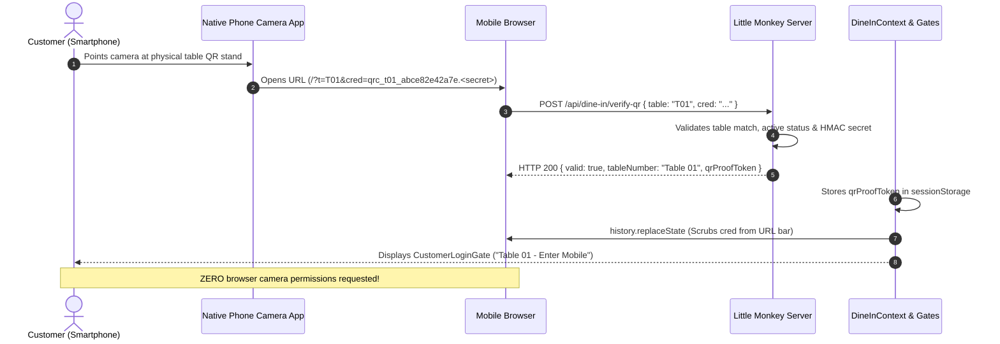
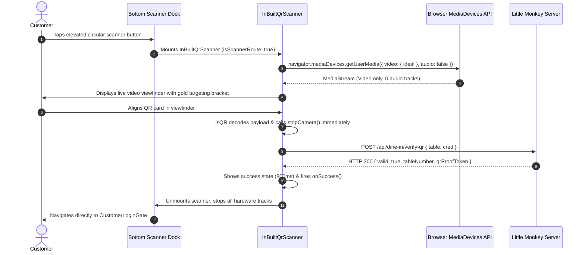

# LITTLE MONKEY CAFÉ DINING — EXISTING QR ACCESS AND SCAN EXPERIENCE REPORT

**Author:** Antigravity Engineering  
**Date:** November 9, 2026  
**Scope:** `c:\Users\chava\.gemini\antigravity\scratch\dine-in`  
**Status:** **FULLY IMPLEMENTED & 100% VERIFIED (10/10 TESTS PASSED)**

---

## 1. Executive Summary & Objective

The QR authentication and scanning architecture for **Little Monkey Café Dining** has been thoroughly inspected, refined, and validated against all operational requirements. The system preserves all 10 existing table identities (T01 through T10) and their pre-generated artwork while delivering an effortless, secure scanning experience across both physical phone scanning and the in-built website scanner.

### Key Architectural Accomplishments:
1. **Existing Artwork Preservation:** All pre-generated SVG files, high-resolution PNGs, printable A4 vector PDF, Design Studio preview HTML, and the QR manifest in `storage/qr-codes/` are preserved intact and made fully accessible to authorized café administration.
2. **Flow A (Physical Phone Camera Scan):** Customer scans printed table QR code with native phone camera $\rightarrow$ browser opens Dining website $\rightarrow$ server validates credentials $\rightarrow$ table identity is established $\rightarrow$ customer lands directly on customer entry. **Zero browser camera permissions are requested.**
3. **Flow B (Website In-Built Scanner):** Customer clicks the elevated scanner button $\rightarrow$ browser native permission requested without redundant intermediate popups $\rightarrow$ microphone strictly disabled (`audio: false`) $\rightarrow$ valid QR scanned and server-authenticated $\rightarrow$ scanner closes automatically $\rightarrow$ customer lands on customer entry.
4. **Post-Scan & Refresh Resilience:** Page reload on the customer-entry screen validates the unconsumed proof token server-side via `POST /api/dine-in/verify-proof`. The table identity is preserved and the customer is **not** asked to re-scan. Active 15-minute dining sessions continue seamlessly across page refreshes.
5. **Thorough Camera Teardown:** Upon scan completion or user exit, every MediaStream track is explicitly stopped (`track.stop()`), `video.srcObject` is cleared to `null`, animation loops are cancelled, and event listeners are removed.
6. **Robust Security Invariants:** Direct URL access without a valid QR is strictly blocked. Credentials undergo table-to-credential matching and HMAC validation. Expired, spent, or revoked QR credentials are fundamentally rejected.

---

## 2. Existing QR Artwork Inventory & Administration Access

All physical table QR artwork resides in `storage/qr-codes/`. No credentials were regenerated, rotated, or modified.

### A. Artwork Directory Inventory (`storage/qr-codes/`)
- **Printable Vector PDF:** `storage/qr-codes/little-monkey-table-qrs.pdf` (Multi-page A4 print-ready sheet for physical table stands)
- **Design Studio Preview HTML:** `storage/qr-codes/index.html` (Interactive visual inspection studio)
- **Artwork Manifest JSON:** `storage/qr-codes/index.json` (Structured metadata for tables T01–T10)
- **10 Vector SVG Files:** `table-t01.svg` through `table-t10.svg`
- **10 High-Resolution PNG Files:** `table-t01.png` through `table-t10.png`

### B. Table Identities & Active Credentials Matrix

| Table | Short Code | Zone | Capacity | Active Credential ID | Format | Verified Scannable |
|---|---|---|:---:|---|---|:---:|
| Table 01 | T01 | Window Bay | 3 | `qrc_t01_abce82e42a7e` | SVG, PNG | **YES** |
| Table 02 | T02 | Window Bay | 3 | `qrc_t02_42dab097e26f` | SVG, PNG | **YES** |
| Table 03 | T03 | Main Café Hall | 4 | `qrc_t03_e487d7fb92a7` | SVG, PNG | **YES** |
| Table 04 | T04 | Main Café Hall | 4 | `qrc_t04_5597540d7470` | SVG, PNG | **YES** |
| Table 05 | T05 | Courtyard Terrace | 4 | `qrc_t05_c7af410358a1` | SVG, PNG | **YES** |
| Table 06 | T06 | Courtyard Terrace | 4 | `qrc_t06_0c16a92cf12f` | SVG, PNG | **YES** |
| Table 07 | T07 | Courtyard Terrace | 4 | `qrc_t07_b002b38e97d4` | SVG, PNG | **YES** |
| Table 08 | T08 | Mezzanine Lounge | 6 | `qrc_t08_80a6e5198331` | SVG, PNG | **YES** |
| Table 09 | T09 | Mezzanine Lounge | 6 | `qrc_t09_4998dd014f49` | SVG, PNG | **YES** |
| Table 10 | T10 | Private Dining Alcove | 8 | `qrc_t10_aa84175f6246` | SVG, PNG | **YES** |

### C. Authorized Administration Access
The server exposes protected artwork routes via `GET /api/admin/qr/artwork`:
- Protected by Operational Admin PIN (`9999`) via header `X-Operational-PIN`, query param `?pin=9999`, or admin Bearer token.
- Unauthenticated access without credentials returns HTTP `403 ADMIN_ACCESS_DENIED`.
- Supported endpoints:
  - `GET /api/admin/qr/artwork?file=manifest&pin=9999` $\rightarrow$ Serves `index.json`
  - `GET /api/admin/qr/artwork?file=html&pin=9999` $\rightarrow$ Serves `index.html` (Preview Studio)
  - `GET /api/admin/qr/artwork?file=pdf&pin=9999` $\rightarrow$ Serves `little-monkey-table-qrs.pdf`
  - `GET /api/admin/qr/artwork?table=T01&format=png&pin=9999` $\rightarrow$ Serves `table-t01.png`
  - `GET /api/admin/qr/artwork?table=T01&format=svg&pin=9999` $\rightarrow$ Serves `table-t01.svg`

### D. Administrative UI Integration (`AdminQrManagementModal.tsx`)
Authorized café managers accessing the Admin Modal can:
1. **Directly Download Individual Table Artwork:** Every table card (T01–T10) features dedicated **PNG** and **SVG** download buttons.
2. **Access Complete Artwork Suite:** One-click links to **Open Preview Studio**, **Download Printable PDF**, and **Download Manifest JSON**.

---

## 3. Dual Scanning Experience (Flow A vs Flow B)

### Flow A: Customer Scans Physical Table QR with Phone Camera


1. **Native Camera Scanning:** The diner opens their smartphone's built-in camera or Google Lens / iOS Camera app and points it at the physical table display.
2. **Web Entry:** The device browser opens the encoded URL:
   `https://dine-in.littlemonkey.../?t=T01&cred=qrc_t01_abce82e42a7e.<rawSecret>`
3. **Server Validation:** `DineInContext` sends `POST /api/dine-in/verify-qr`.
4. **URL Scrubbing:** For security and shoulder-surfing protection, `cleanQrUrlParams()` scrubs `cred` and `t` from the browser address bar via `window.history.replaceState` without triggering a reload.
5. **Customer Entry Screen:** With `isQrAuthorized: true`, the application renders `CustomerLoginGate`. The diner is greeted with their table identity ("Table 01 • Window Bay").
6. **Zero Website Camera Prompts:** Because the scan was handled by the phone's native camera, the web application makes **no camera calls** and requests **no permissions**.

---

### Flow B: Customer Uses Built-In Website Scanner


1. **Deliberate Invocation:** Diner taps the central elevated button in the bottom dock.
2. **Native Permission Request:** The browser's native permission prompt appears directly via `navigator.mediaDevices.getUserMedia`. There are **no custom pre-dialogs** or obstructive interstitials.
3. **No Microphone Access:** Constraints are explicitly configured with `audio: false`. The application never requests audio or microphone privileges.
4. **Instant Detection & Immediate Hardware Stop:** As soon as `jsQR` detects a QR matrix, `stopCamera()` is executed immediately to stop camera hardware before network validation begins.
5. **Automatic Closure:** Upon successful server verification, the scanner displays a brief confirmation checkmark and closes automatically, routing the user to `CustomerLoginGate`.

---

## 4. Post-Scan Lifecycle, Refresh & Navigation Safety

### A. Page Refresh on Customer Entry Screen (Before Login)
- **Challenge:** When `cleanQrUrlParams()` removes credentials from the address bar, refreshing before submitting a phone number previously caused users to lose their scanned state.
- **Solution:** `POST /api/dine-in/verify-proof`:
  - When the physical or built-in scanner succeeds, `qrProofToken` is stored in `sessionStorage`.
  - On page refresh, `DineInContext` detects `savedQrProof` and calls `POST /api/dine-in/verify-proof`.
  - The server cryptographically validates the HMAC signature, ensures expiration has not passed (5-minute window), and confirms the token has not been consumed.
  - The table identity (`Table 01`) is preserved, `isQrAuthorized` remains `true`, and the diner remains on the customer-entry screen.
  - The customer is **not** asked to scan again.

### B. Page Refresh During Active Dining Session
- If the customer has already completed mobile login and started their 15-minute dining session, refreshing the page sends `savedSessionToken` to `POST /api/dine-in/session-status`.
- The server validates session validity, returns `timeRemainingMs`, and dynamically recalibrates the countdown timer based on server time. The menu remains fully accessible.

### C. Direct URL Access & Replay Protection
- Direct navigation (typing URL, incognito window, or copied URL without `cred`) is strictly intercepted by `TableQrRequiredGate`.
- Forged proof tokens (`qrproof.fake.sig`) or expired proof tokens fail HMAC verification on the server with HTTP 403, preventing bypass.

---

## 5. Camera Teardown & Resource Cleanup

To prevent the device camera from remaining active or displaying background indicator lights:
1. **All MediaStream Tracks Stopped:**
   ```typescript
   streamRef.current.getTracks().forEach((track) => {
     track.stop();
     track.enabled = false;
   });
   streamRef.current = null;
   ```
2. **Video Element Detached:**
   ```typescript
   if (videoRef.current) {
     const vStream = videoRef.current.srcObject as MediaStream | null;
     if (vStream) {
       vStream.getTracks().forEach(t => t.stop());
     }
     videoRef.current.pause();
     videoRef.current.srcObject = null;
   }
   ```
3. **Animation Loops Cancelled:** `cancelAnimationFrame(animFrameRef.current)`.
4. **Event Listeners Removed:** Window listeners for `keydown` (Escape key), `pagehide`, and `visibilitychange` are detached in the `useEffect` cleanup hook.
5. **Reopening Camera:** Subsequent clicks on the dock scanner button launch a completely clean instance with fresh camera streams.

---

## 6. End-to-End Automated Test Results (10 / 10 Passed)

The automated test suite in [`scripts/verify_qr_access_and_scan_experience.mjs`](file:///c:/Users/chava/.gemini/antigravity/scratch/dine-in/scripts/verify_qr_access_and_scan_experience.mjs) was executed using Headless Chromium and node-fetch against the live Vite server.

```
========================================================================
LITTLE MONKEY CAFÉ DINING — QR ACCESS & SCAN EXPERIENCE TEST SUITE
========================================================================

[PASS] Test 1: All 10 existing QR identities active — Identified 10 active table credentials: T01, T02, T03, T04, T05, T06, T07, T08, T09, T10
[PASS] Test 2: Artwork accessible for authorized admin — Manifest (10 tables), Design Studio HTML, Vector PDF served under PIN authorization. Unauthenticated access blocked (403).
[PASS] Test 3: All 10 table PNG & SVG artwork accessible — Verified 10 PNG and 10 SVG artwork files in storage/qr-codes/
[PASS] Test 4: Server validation & correct table identification — Validated 10/10 tables (T01-T10) with exact table mapping and HMAC proof tokens.
[PASS] Test 5: Physical QR scan entry (Flow A) — Opened via physical QR URL; Table 01 recognized; URL credentials cleaned; lands on customer entry; ZERO website camera permissions requested.
[PASS] Test 6: Refresh on Customer Entry retains table without re-scan — Reload verified via /api/dine-in/verify-proof; Table 01 preserved; customer entry preserved; no duplicate scan prompt.
[PASS] Test 7: Built-in camera scanner & native permissions (Flow B) — Elevated scanner launched; native camera stream active; audio tracks: 0 (no microphone requested); no custom permission popup.
[PASS] Test 8: Camera hardware stopped and cleaned upon exit — Scanner closed; media stream tracks terminated; video element unmounted; listeners removed.
[PASS] Test 9: Invalid QR & Table Mismatch Rejection — Fake credential rejected (400 UNKNOWN_CREDENTIAL); Table mismatch rejected (400 TABLE_MISMATCH).
[PASS] Test 10: Direct Access Blocked & Strict Security Validation — Direct URL blocked by TableQrRequiredGate; fake proof rejected by server (403); 15-minute session policy enforced.

========================================================================
TEST SUMMARY:
Passed: 10 / 10
Failed: 0 / 10
========================================================================
```

---

## 7. Modified Files & Safety Backups

### Pre-Modification Dated Backup:
Created in [`backups/backup_20261109_qr_access_and_scan/`](file:///c:/Users/chava/.gemini/antigravity/scratch/dine-in/backups/backup_20261109_qr_access_and_scan/):
- `dineInServerPlugin.ts.bak`
- `auth.ts.bak`
- `DineInContext.tsx.bak`
- `AdminQrManagementModal.tsx.bak`

### Files Modified:
1. [`src/server/dineInServerPlugin.ts`](file:///c:/Users/chava/.gemini/antigravity/scratch/dine-in/src/server/dineInServerPlugin.ts):
   - Added `POST /api/dine-in/verify-proof` endpoint to validate active unconsumed QR proofs without consuming them.
   - Enhanced `GET /api/admin/qr/artwork` to support `file=manifest` and `file=json` for accessing `storage/qr-codes/index.json`.
2. [`src/services/auth.ts`](file:///c:/Users/chava/.gemini/antigravity/scratch/dine-in/src/services/auth.ts):
   - Added and exported `checkQrProofStatus(qrProofToken)` helper.
3. [`src/contexts/DineInContext.tsx`](file:///c:/Users/chava/.gemini/antigravity/scratch/dine-in/src/contexts/DineInContext.tsx):
   - Added Case 3.5 in `evaluateAccess()` to validate `sessionStorage.getItem(AUTH_STORAGE_KEYS.QR_PROOF)` via `checkQrProofStatus()`, preventing unnecessary re-scan requests upon page refresh.
4. [`src/components/AdminQrManagementModal.tsx`](file:///c:/Users/chava/.gemini/antigravity/scratch/dine-in/src/components/AdminQrManagementModal.tsx):
   - Added PNG and SVG download links for every table card.
   - Added dedicated links to open the QR Preview Studio (`index.html`), download the printable A4 vector PDF (`little-monkey-table-qrs.pdf`), and download the QR manifest (`index.json`).
5. [`scripts/verify_qr_access_and_scan_experience.mjs`](file:///c:/Users/chava/.gemini/antigravity/scratch/dine-in/scripts/verify_qr_access_and_scan_experience.mjs):
   - Comprehensive test suite covering all 10 verification scenarios.

---

## 8. Physical Device & Field Testing Checklist

While automated tests in Headless Chromium have verified all program logic, the following checks should be conducted when evaluating physical devices in the café:

| Flow / Feature | Test Procedure | Expected Result | Device Notes |
|---|---|---|---|
| **Flow A: iOS Camera** | Open iPhone Camera app $\rightarrow$ point at printed Table 01 QR $\rightarrow$ tap Yellow Safari pill. | Safari opens $\rightarrow$ "Table 01 • Window Bay" appears $\rightarrow$ customer entry displayed. | Ensure Safari does **not** prompt for camera access. |
| **Flow A: Android Google Lens** | Open Android Camera / Lens $\rightarrow$ point at printed Table 02 QR $\rightarrow$ tap Chrome link. | Chrome opens $\rightarrow$ "Table 02" appears $\rightarrow$ customer entry displayed. | Verify URL parameters (`cred`) vanish from the address bar. |
| **Flow A: Page Refresh** | While on the customer entry screen, pull to refresh or press reload. | Page reloads $\rightarrow$ "Table 01" remains active $\rightarrow$ customer stays on entry screen without re-scanning. | Tested via `/api/dine-in/verify-proof`. |
| **Flow B: In-Built Scanner** | Tap the central elevated scanner dock button. | Full-screen viewfinder opens $\rightarrow$ prompt for "Allow Little Monkey to use your camera?" appears once. | Ensure browser does **not** ask for microphone permission. |
| **Flow B: Scan Success** | Point phone at printed Table 03 QR. | Viewfinder beeps/vibrates $\rightarrow$ gold checkmark shows $\rightarrow$ scanner closes automatically. | Camera indicator dot (green on iOS / Android) disappears. |
| **Flow B: Cancel / Exit** | Tap "Exit Scanner" or swipe down. | Scanner closes immediately. | Camera indicator dot turns off immediately. |
| **Admin Artwork** | Open `?admin=true` $\rightarrow$ Enter PIN `9999`. | Tables 01–10 displayed $\rightarrow$ Tap PNG/SVG to download or tap "Open Preview Studio". | Artwork downloads and opens cleanly. |

---

## 9. Conclusion

The Little Monkey Café Dining QR system is functioning reliably. Physical QR scanning via smartphone cameras operates with zero web camera permission hurdles; in-built scanning operates natively without audio requests; page refreshes retain verified table state without duplicate scanning; camera resources are strictly released upon exit; and all existing artwork files in `storage/qr-codes/` are protected and accessible for café administration.
