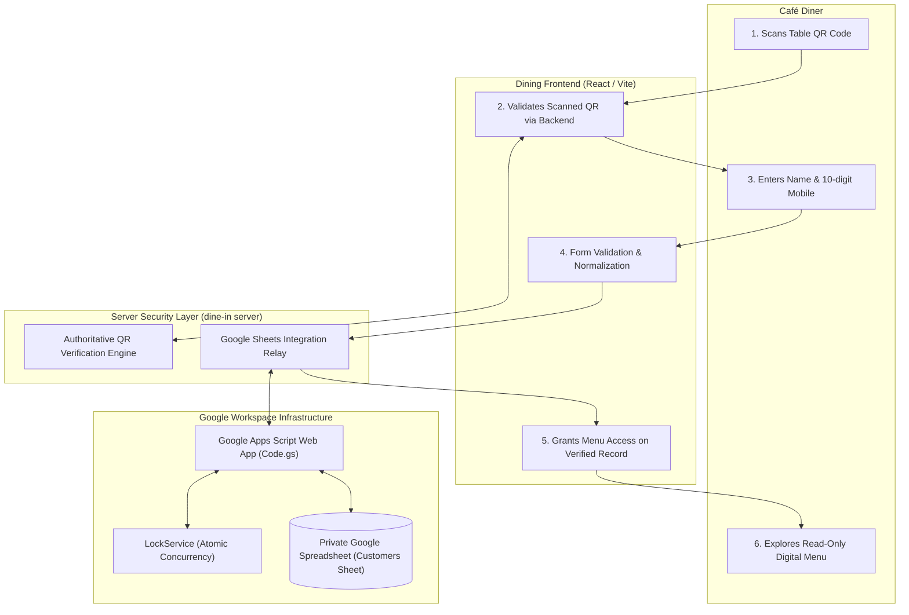
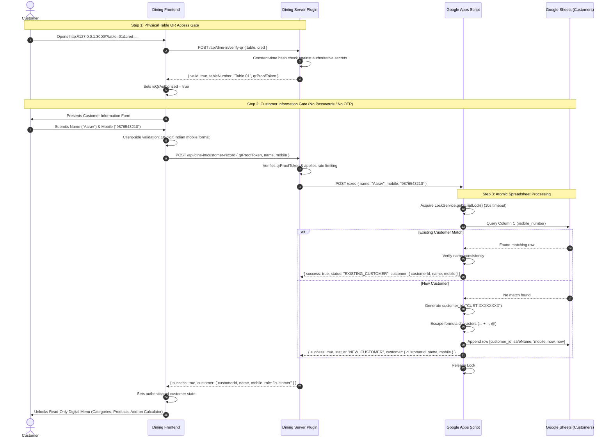

# Little Monkey Café Dining — Architecture & Data Flow

## 1. System Architecture Overview

The Little Monkey Café Dining application uses a **Google Sheets-first architecture** for customer record registration and retrieval, coupled with **server-authoritative physical QR validation** and a **read-only digital menu**.

---

## 2. End-to-End Sequence Flow

---

## 3. Component Responsibilities & Boundaries

### A. Dining Frontend (Vite / React)
- **Role:** Pure presentation and user interaction.
- **Responsibilities:**
  - Extracts and holds QR credentials from URL / physical scan.
  - Presents the mandatory customer entry form before menu discovery.
  - Client-side validation of name (1 to 60 chars) and mobile number (10 digits starting with 6, 7, 8, or 9).
  - Displays clear error banners if Google Sheets integration fails or times out.
  - Renders category-only landing page, category detail modal/sheet, and interactive product details.
  - Zero cart drawers, zero checkout buttons, and zero session countdown clocks.

### B. Dining Server Security Layer (`dineInServerPlugin.ts`)
- **Role:** Security boundary and trusted broker.
- **Responsibilities:**
  - Validates physical table QR cryptographic credentials.
  - Prevents public scrapers from spamming the Google Apps Script endpoint by requiring a verified `qrProofToken`.
  - Enforces IP sliding-window rate limiting (15 requests/min per IP).
  - Eliminates exposure of Google API secrets or credentials in frontend JavaScript.

### C. Google Apps Script Integration Layer (`Code.gs`)
- **Role:** Business logic and data mapper.
- **Responsibilities:**
  - Enforces `LockService` to guarantee atomic serial writes, preventing race-condition duplicate customer records.
  - Sanitizes user input against formula injection.
  - Normalizes 10-digit mobile numbers.
  - Performs deduplication lookup against column C.
  - Returns strictly the minimal necessary customer object (`customerId`, `name`, `mobile`).

### D. Private Google Spreadsheet (`Customers`)
- **Role:** Master record store.
- **Responsibilities:**
  - Secure, restricted storage of customer dining visits.
  - Access is restricted exclusively to the café Google account.
  - No public read or write permissions.
