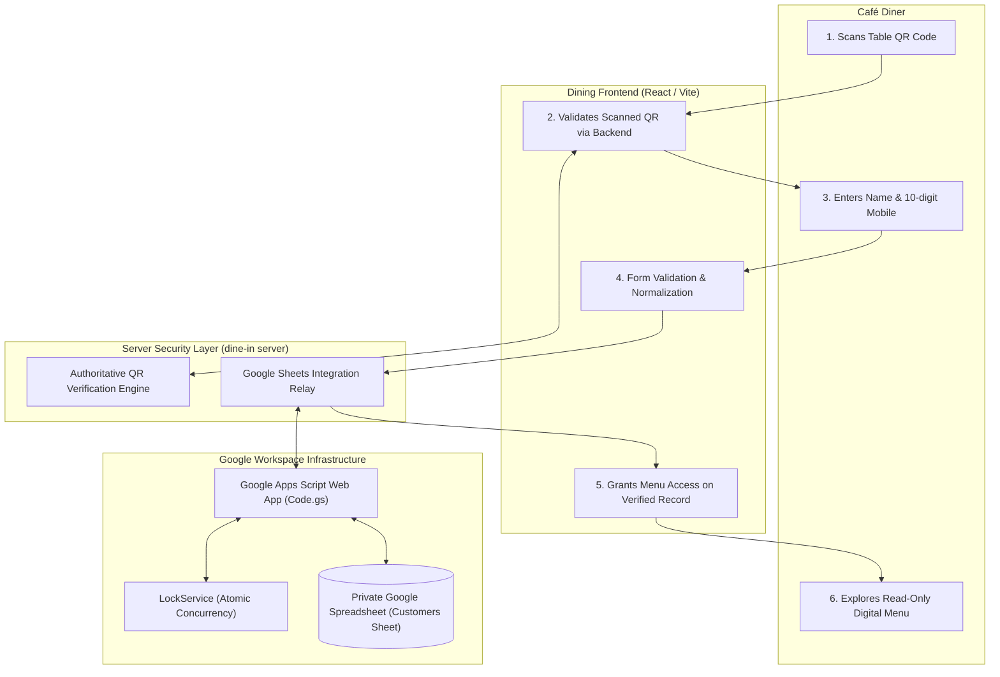

# Little Monkey Café Dining — Google Sheets-First Architecture & Design Report

## 1. Executive Summary

This report documents the architectural design, security analysis, schema specifications, and setup instructions for the **Google Sheets-First customer registration system** and the planned **removal of customer-facing session timers** for Little Monkey Café Dining (`C:\Users\chava\.gemini\antigravity\scratch\dine-in`).

In strict compliance with the project guidelines:
- **Phase A (Project Inspection)** and **Phase B (Architecture & Security Design)** have been executed.
- No application code was modified during this planning phase.
- No live connections to external Google services have been attempted.
- The project owner is guided through manual spreadsheet creation without prematurely demanding a deployed endpoint.

---

## 2. Inventory of Project Documentation

| Document | Path | Status | Summary |
| :--- | :--- | :--- | :--- |
| **Spreadsheet Schema** | [`docs/GOOGLE_SHEETS_SCHEMA.md`](file:///C:/Users/chava/.gemini/antigravity/scratch/dine-in/docs/GOOGLE_SHEETS_SCHEMA.md) | **Found & Verified** | Defines `Customers` tab: `customer_id`, `name`, `mobile_number`, `created_at`, `updated_at`. |
| **Setup Guide** | [`docs/GOOGLE_SHEETS_SETUP_GUIDE.md`](file:///C:/Users/chava/.gemini/antigravity/scratch/dine-in/docs/GOOGLE_SHEETS_SETUP_GUIDE.md) | **Found & Verified** | Manual setup instructions for Google Sheets and production Apps Script code. |
| **Architecture Specification** | [`docs/GOOGLE_SHEETS_ARCHITECTURE.md`](file:///C:/Users/chava/.gemini/antigravity/scratch/dine-in/docs/GOOGLE_SHEETS_ARCHITECTURE.md) | **Found & Verified** | End-to-end data flow, sequence diagram, and security boundary definition. |
| **Integration Contract** | [`docs/INTEGRATION_CONTRACT.md`](file:///C:/Users/chava/.gemini/antigravity/scratch/dine-in/docs/INTEGRATION_CONTRACT.md) | **Found & Verified** | JSON schemas, Indian mobile validation rules, and customer privacy notice. |
| **Security Review** | [`docs/SECURITY_REVIEW.md`](file:///C:/Users/chava/.gemini/antigravity/scratch/dine-in/docs/SECURITY_REVIEW.md) | **Found & Enhanced** | Threat modeling, formula injection mitigation, lock concurrency, and answers to all 12 security queries. |
| **Implementation Plan** | [`docs/IMPLEMENTATION_PLAN.md`](file:///C:/Users/chava/.gemini/antigravity/scratch/dine-in/docs/IMPLEMENTATION_PLAN.md) | **Found & Updated** | Phased rollout plan, session timer safe removal map, and approval gate. |
| **Design Report** | [`docs/google_sheets_first_architecture_and_design_report.md`](file:///C:/Users/chava/.gemini/antigravity/scratch/dine-in/docs/google_sheets_first_architecture_and_design_report.md) | **Created in this run** | Master summary linking all design deliverables. |

---

## 3. Architecture & Data Flow

---

## 4. Key Security & Architectural Principles

1. **Physical QR Gating Preserved:** Menu access requires a valid, server-verified cryptographic table QR code (`qrProofToken`). Browser-supplied table numbers are never trusted without cryptographic proof.
2. **Backend Relay Proxy Shield:** Browser code does not directly contact Google Apps Script. All customer registrations are relayed through `/api/dine-in/customer-record`, which enforces rate limiting and verifies physical presence.
3. **Formula Injection Defense:** `sanitizeFormula()` prefixes any user string starting with `=`, `+`, `-`, `@`, `\t`, or `\r` with a literal single quote (`'`), rendering it inert text.
4. **Concurrency Safety:** `LockService.getScriptLock()` prevents race-condition duplicate customer creation.
5. **Session Timers Removed:** Customer-facing session countdowns, inactivity timers, and automatic 15-minute lockouts are scheduled for removal, allowing relaxed menu browsing. Physical QR security and administrative table revocation remain active.
6. **Read-Only Menu Integrity:** The menu remains strictly informational with transparent add-on portion price calculation preview. No cart, checkout, or order placement capabilities exist.

---

## 5. Next Steps for Owner Setup

Before Phase C code implementation begins, the project owner should:
1. Review the proposed schema in [`docs/GOOGLE_SHEETS_SCHEMA.md`](file:///C:/Users/chava/.gemini/antigravity/scratch/dine-in/docs/GOOGLE_SHEETS_SCHEMA.md).
2. Follow the manual creation steps in [`docs/GOOGLE_SHEETS_SETUP_GUIDE.md`](file:///C:/Users/chava/.gemini/antigravity/scratch/dine-in/docs/GOOGLE_SHEETS_SETUP_GUIDE.md) to create the private spreadsheet and configure Apps Script.
3. Review the security findings in [`docs/SECURITY_REVIEW.md`](file:///C:/Users/chava/.gemini/antigravity/scratch/dine-in/docs/SECURITY_REVIEW.md).
4. Provide confirmation to proceed with Phase C implementation.
