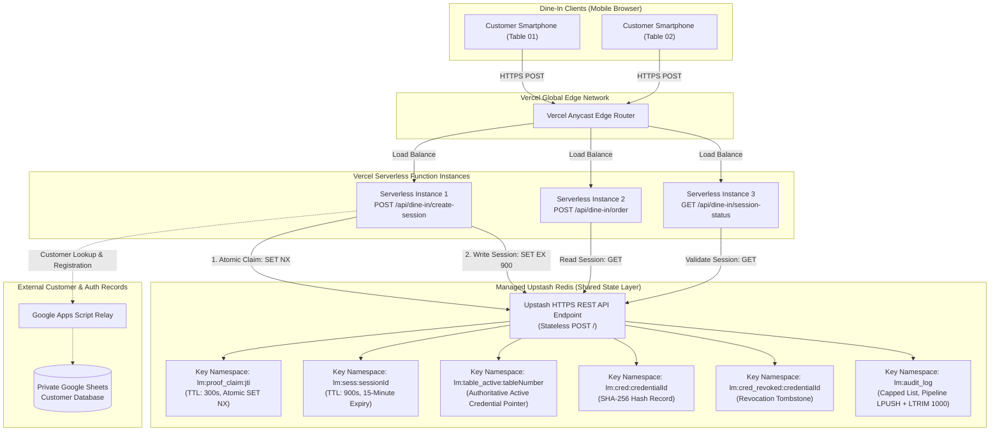
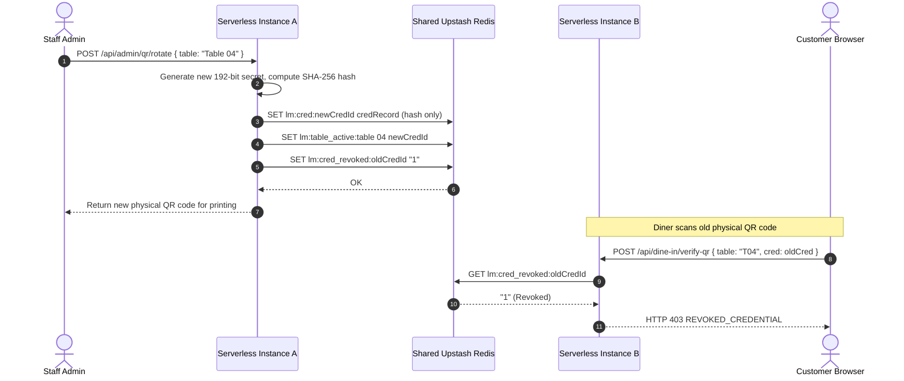

# Little Monkey Cafe Dining — Shared Redis Storage Architecture

## 1. Overview and Problem Statement

The Little Monkey Cafe Dining application deploys to Vercel as a serverless application serving production traffic at `https://dine-in.littlemonkey.com`.

In a serverless architecture:
- Requests execute across multiple ephemeral, stateless Node.js execution environments (containers) dynamically provisioned and scaled by Vercel.
- In-memory state (JavaScript `Map` objects, global variables) is isolated to individual containers and is purged when instances freeze or terminate.
- Local filesystem state (ephemeral write layers) is not shared across parallel instances and disappears when containers spin down.

Without an external, low-latency shared coordination layer, distributed failure modes occur:
1. **QR Proof Replay Vulnerability**: An attacker intercepts a short-lived QR verification proof token. If Serverless Instance A processes the original scan and Serverless Instance B receives a replayed copy, Instance B has no record of Instance A's consumption, allowing unauthorized dining session generation.
2. **Session Fragmentation and Loss**: A customer scans the table QR on Serverless Instance A (which issues session cookie `dinesess_xyz`). Subsequent order submissions or status checks route to Serverless Instance B or C. These instances cannot see the session created on Instance A, returning `401 Unauthorized` and disrupting dining service.
3. **Table Credential Inconsistency**: When staff revoke or rotate a table credential on Instance A, Instance B continues accepting the old credential if rotation state is stored locally on disk.

To resolve these problems without introducing heavy relational databases or violating serverless connection constraints, Little Monkey Cafe Dining utilizes a shared Upstash Redis storage provider operating exclusively over stateless HTTPS REST calls.

---

## 2. Distributed Architecture Diagram



---

## 3. Key Namespace Design and Schema

All keys used by the dining application are strictly prefixed with `lm:` to prevent collisions and simplify capacity monitoring.

| Key Pattern | Data Type | Payload Schema | Purpose | Lifetime (TTL) | Eviction Policy |
| :--- | :--- | :--- | :--- | :--- | :--- |
| `lm:proof_claim:<jti>` | String | `<customerId>` | Atomic claim on a QR proof token. Maps proof JTI to claimant customer ID. Set via atomic `SET ... NX`. Enables safe recovery upon client retry. | 300 seconds (5 minutes) | Volatile TTL (auto-expires with proof validity window) |
| `lm:sess:<sessionId>` | String (JSON) | `{"sessionId": string, "tableNumber": string, "credentialId": string, "customerId": string, "customerName": string, "customerPhone": string, "role": string, "createdAt": number, "expiresAt": number, "isActive": boolean}` | Active dining session record accessible by all serverless instances worldwide. PII minimized (no IP or User-Agent). | 900 seconds (15 minutes) | Volatile TTL (auto-expires at 15 minutes) |
| `lm:table_active:<tableNumber>` | String | `<credentialId>` or `"REVOKED"` | Authoritative dynamic pointer indicating which credential is currently active for a table. | Persistent | Manual rotation or revocation |
| `lm:cred:<credentialId>` | String (JSON) | `{"credentialId": string, "tableNumber": string, "tableShortCode": string, "secretHash": string, "isActive": boolean, "createdAt": string, "rotationCount": number}` | Public metadata and SHA-256 hash for rotated credentials. Zero raw secrets. | Persistent | Retained for audit and validation |
| `lm:cred_revoked:<credentialId>` | String | `"1"` | Fast tombstone marker indicating the credential has been revoked. | Persistent | Permanent revocation marker |
| `lm:audit_log` | List (JSON) | `{"tableNumber": string, "eventType": string, "status": string, "userAgent": string, "metadata": object, "createdAt": string}` | Security and operational audit log of QR scans, replay blocks, and session creations. | Indefinite, capped at 1,000 items | Atomic `/pipeline` `LPUSH` + `LTRIM 0 999` |

---

## 4. Sequence Diagrams

### 4.1 Session Creation and Idempotent Recovery Sequence

```mermaid
sequenceDiagram
    autonumber
    actor Customer as Customer Browser
    participant Lambda as Serverless Instance
    participant Redis as Shared Upstash Redis

    Customer->>Lambda: POST /api/dine-in/create-session (qrProofToken, customer)
    Lambda->>Lambda: Verify HMAC signature and expiration on proof token
    Lambda->>Lambda: Compute deterministic sessionId = HMAC(jti:customerId)
    Lambda->>Redis: SET lm:proof_claim:jti customerId EX 300 NX

    alt First Attempt (result === 'OK')
        Redis-->>Lambda: OK
        Lambda->>Redis: SET lm:sess:sessionId sessionData EX 900
        Redis-->>Lambda: OK
        Lambda-->>Customer: Set-Cookie: lm_dining_session=...; Secure; HttpOnly
    else Retry by Same Customer (result === null)
        Redis-->>Lambda: null
        Lambda->>Redis: GET lm:proof_claim:jti
        Redis-->>Lambda: storedCustomerId
        alt storedCustomerId === customer.id (Idempotent Recovery)
            Lambda->>Redis: GET lm:sess:sessionId
            alt Session exists
                Redis-->>Lambda: sessionData
            else Previous session write failed
                Lambda->>Redis: SET lm:sess:sessionId sessionData EX 900
                Redis-->>Lambda: OK
            end
            Lambda-->>Customer: Set-Cookie: lm_dining_session=...; Secure; HttpOnly
        else storedCustomerId !== customer.id (Replay Attack)
            Lambda-->>Customer: HTTP 403 PROOF_ALREADY_USED
        end
    end
```

### 4.2 Distributed Table Credential Rotation Sequence



---

## 5. Serverless Filesystem Constraints and Decoupling

In traditional server-centric applications, state changes are often persisted by rewriting local JSON or SQLite files on disk. In serverless execution:
1. Container filesystems are read-only or ephemeral.
2. Multiple parallel instances do not share disk volumes.
3. Writing to disk on one instance does not affect any other instance.

`RedisStorageProvider` in [src/server/storage.ts](file:///C:/Users/chava/.gemini/antigravity/scratch/dine-in/src/server/storage.ts) strictly avoids disk mutation:
- Baseline credentials generated during system setup are read as read-only seeds if no dynamic Redis override exists.
- All credential rotations, revocations, and overrides are stored exclusively in Redis (`lm:table_active:*`, `lm:cred:*`, `lm:cred_revoked:*`).
- Local `.qr_credentials.json` remains completely untouched during serverless operations, preserving clean separation between distributed cloud state and local developer baselines.

---

## 6. Performance, Latency and Capacity Headroom

### Latency Profiles
- **Stateless HTTPS REST Overhead**: Native `fetch()` calls to Upstash Redis take 2ms - 8ms when deployed in matching regions (Vercel Mumbai `bom1` <-> Upstash AWS `ap-south-1`).
- **Zero TCP Handshake Bottleneck**: Upstash HTTPS REST requests reuse keep-alive HTTP/1.1 or HTTP/2 sockets within container instances, minimizing cold-start impact.
- **Pipeline Efficiency**: Audit logging combines `LPUSH` and `LTRIM` into a single `/pipeline` HTTP request, halving network latency.

### Free-Tier Capacity Headroom Analysis

| Resource Metric | Upstash Free Tier Allowance | Little Monkey Estimated Daily | Little Monkey Monthly Total | Free Tier Utilization % | Safety Headroom |
| :--- | :--- | :--- | :--- | :--- | :--- |
| Monthly Commands | 500,000 commands | ~560 commands/day | ~16,800 commands/month | **3.36%** | **29.7x headroom** |
| Max Data Storage | 256 Megabytes | ~150 Kilobytes | ~200 Kilobytes | **0.08%** | **1,280x headroom** |
| Bandwidth | 10 Gigabytes / month | ~1.5 Megabytes / day | ~45 Megabytes / month | **0.45%** | **222x headroom** |
| Concurrent Connections | Unlimited (Stateless HTTP) | N/A | N/A | N/A (Stateless) | No connection limits |
