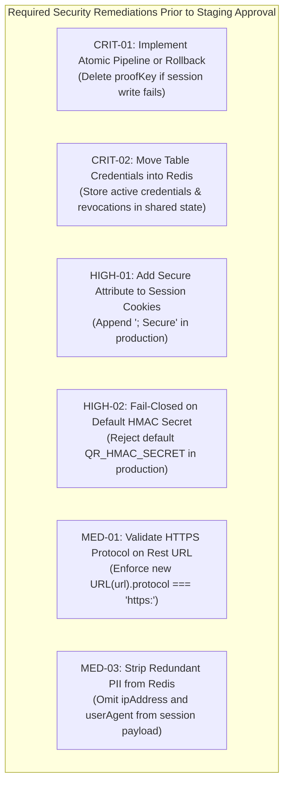

# Little Monkey Cafe Dining — Phase 1.4.1 Independent Redis Security Audit

## 1. Executive Summary & Verdict

This report presents an independent, read-only security and architecture audit of the Phase 1.4 Shared Redis storage implementation for the Little Monkey Cafe Dining application.

Every claim from the Phase 1.4 implementation report was scrutinized against the actual source code in [src/server/redisClient.ts](file:///C:/Users/chava/.gemini/antigravity/scratch/dine-in/src/server/redisClient.ts), [src/server/storage.ts](file:///C:/Users/chava/.gemini/antigravity/scratch/dine-in/src/server/storage.ts), [src/server/config.ts](file:///C:/Users/chava/.gemini/antigravity/scratch/dine-in/src/server/config.ts), [src/server/qrAuthStore.ts](file:///C:/Users/chava/.gemini/antigravity/scratch/dine-in/src/server/qrAuthStore.ts), the Vercel serverless API routes in [api/dine-in/](file:///C:/Users/chava/.gemini/antigravity/scratch/dine-in/api/dine-in), and the automated test suite in [scripts/test_redis_storage_suite.mjs](file:///C:/Users/chava/.gemini/antigravity/scratch/dine-in/scripts/test_redis_storage_suite.mjs).

### Audit Verdict: NOT READY

**Justification**:
While the shared Redis storage abstraction correctly implements atomic `SET NX` single-use replay prevention and successfully fails closed when Redis is unconfigured in production, the implementation contains critical and high-risk flaws that must be addressed before deployment:
1. **Uncompensated Two-Phase Token Burn**: In [src/server/storage.ts](file:///C:/Users/chava/.gemini/antigravity/scratch/dine-in/src/server/storage.ts#L129-L175), `createSession` burns the single-use QR proof token in Redis before creating the session. If the subsequent session write times out or fails, the proof token remains permanently marked as spent, locking the legitimate customer out with `PROOF_ALREADY_USED` upon retry.
2. **Serverless Credential State Isolation**: In [src/server/storage.ts](file:///C:/Users/chava/.gemini/antigravity/scratch/dine-in/src/server/storage.ts#L295-L325), table credential rotation and revocation methods continue to delegate to local file storage (`.qr_credentials.json`). In Vercel serverless, dynamic administrative rotations or table revocations on Instance A do NOT propagate to Instance B or C.
3. **Missing `Secure` Cookie Attribute**: In [api/dine-in/create-session.ts](file:///C:/Users/chava/.gemini/antigravity/scratch/dine-in/api/dine-in/create-session.ts#L46-L48) and [src/server/dineInServerPlugin.ts](file:///C:/Users/chava/.gemini/antigravity/scratch/dine-in/src/server/dineInServerPlugin.ts#L1037-L1039), the `lm_dining_session` session cookie is set with `HttpOnly` and `SameSite=Lax`, but lacks the `Secure` flag, exposing session tokens to transmission over plaintext HTTP.
4. **Hardcoded Fallback Cryptographic Secret**: In [src/server/qrAuthStore.ts](file:///C:/Users/chava/.gemini/antigravity/scratch/dine-in/src/server/qrAuthStore.ts#L120), `HMAC_SECRET` falls back to a hardcoded string if `QR_HMAC_SECRET` is unset, allowing trivial signature forgery.
5. **100% Mocked Test Execution**: The Phase 1.4 automated test suite ran exclusively against an in-memory single-threaded JavaScript mock; zero live Redis integration tests were performed.

---

## 2. Detailed Findings by Severity

### Critical Vulnerabilities

#### [CRIT-01] Two-Phase Partial Failure Permanently Locks Out Legitimate Customers
- **Location**: [src/server/storage.ts](file:///C:/Users/chava/.gemini/antigravity/scratch/dine-in/src/server/storage.ts#L129-L175)
- **Description**: In `RedisStorageProvider.createSession`, proof token consumption and session persistence are performed across two independent network roundtrips to Redis:
  1. `this.redis.set(proofKey, '1', { ex: 300, nx: true })` (Step 2)
  2. `this.redis.set(sessionKey, JSON.stringify(session), { ex: 900 })` (Step 4)
- **Failure Mechanics**: If Step 1 succeeds, but Step 2 fails due to a network timeout, transient Upstash error, or container crash, the function enters the catch block ([L194-L206](file:///C:/Users/chava/.gemini/antigravity/scratch/dine-in/src/server/storage.ts#L194-L206)) and returns `STORAGE_UNAVAILABLE`. No rollback (`this.redis.del(proofKey)`) is performed. When the customer retries the operation, Step 1 evaluates `set(... NX)` against the existing key, returning `null`. The customer is permanently rejected with `PROOF_ALREADY_USED`, effectively burning their proof token without issuing a dining session.
- **Impact**: Legitimate diners scanning valid table QR codes are blocked from dining and forced to re-scan physically.
- **Remediation**: Execute proof consumption and session creation in an atomic transaction (e.g. an Upstash REST pipeline or Redis Lua script) or implement an explicit compensating rollback in the error catch block to delete `proofKey` if session persistence fails.

#### [CRIT-02] Dynamic Table Credential Rotations and Revocations Do Not Propagate Across Serverless Instances
- **Location**: [src/server/storage.ts](file:///C:/Users/chava/.gemini/antigravity/scratch/dine-in/src/server/storage.ts#L295-L325)
- **Description**: `RedisStorageProvider` implements table credential management by delegating directly to `fileGetCredentialById`, `fileGetActiveCredentialForTable`, `fileGenerateTableCredential`, and `fileRevokeTableCredential`.
- **Failure Mechanics**: These file functions read and write to process-local variables (`_credentialsMap`, `_activeSecretsMap`) and disk files (`.qr_credentials.json`, `.active_qr_secrets.json`). In Vercel serverless execution, each lambda container possesses an independent, isolated, read-only/ephemeral filesystem. If café staff rotates or revokes Table 03's credential via `POST /api/admin/qr/rotate` on Container A, Containers B and C running on other nodes have zero awareness of the change. Customers scanning revoked QR codes will continue to be authenticated by Container B.
- **Impact**: Administrative table QR rotation and emergency revocation are non-functional in distributed production.
- **Remediation**: Move active table credentials and revocation tombstones into shared Redis storage (e.g. `lm:table_cred:<tableNumber>` and `lm:revoked_cred:<credentialId>`) so all serverless instances immediately share the authoritative credential state.

---

### High-Risk Findings

#### [HIGH-01] Missing `Secure` Attribute on Dining Session Cookies
- **Location**: [api/dine-in/create-session.ts](file:///C:/Users/chava/.gemini/antigravity/scratch/dine-in/api/dine-in/create-session.ts#L46-L48), [src/server/dineInServerPlugin.ts](file:///C:/Users/chava/.gemini/antigravity/scratch/dine-in/src/server/dineInServerPlugin.ts#L1037-L1039)
- **Description**: The Set-Cookie header issued upon dining session creation is constructed as:
  ```typescript
  res.setHeader('Set-Cookie', [
    `lm_dining_session=${encodeURIComponent(session.sessionId)}; Path=/; Max-Age=${maxAgeSec}; SameSite=Lax; HttpOnly`,
  ]);
  ```
- **Failure Mechanics**: The cookie omits the `Secure` flag. If a customer enters `http://dine-in.littlemonkey.com` on an insecure café Wi-Fi network before an HTTPS redirect occurs, the browser transmits the cleartext `lm_dining_session` cookie in the HTTP request header, allowing network eavesdroppers to hijack active dining sessions.
- **Impact**: Session hijacking over open wireless networks.
- **Remediation**: Append `; Secure` to the `Set-Cookie` header in production environments (`isProduction() ? '; Secure' : ''`).

#### [HIGH-02] Hardcoded Fallback Cryptographic HMAC Secret
- **Location**: [src/server/qrAuthStore.ts](file:///C:/Users/chava/.gemini/antigravity/scratch/dine-in/src/server/qrAuthStore.ts#L120)
- **Description**: `const HMAC_SECRET = process.env.QR_HMAC_SECRET || 'lm_qr_hmac_secret_2026_warangal_dining';`
- **Failure Mechanics**: If an operator forgets to configure `QR_HMAC_SECRET` in Vercel environment variables, the server silently falls back to a publicly known string in the repository. An attacker knowing this string can forge arbitrarily signed QR proof tokens (`qrproof.<payload>.<sig>`) for any table number without physically scanning a QR code.
- **Impact**: Full authentication bypass if environment configuration is omitted.
- **Remediation**: Enforce fail-closed validation in [src/server/config.ts](file:///C:/Users/chava/.gemini/antigravity/scratch/dine-in/src/server/config.ts): throw an error on startup in production if `QR_HMAC_SECRET` is unset or matches the default value.

#### [HIGH-03] Ambiguous Network Timeouts Cause False Replay Rejections on Retry
- **Location**: [src/server/redisClient.ts](file:///C:/Users/chava/.gemini/antigravity/scratch/dine-in/src/server/redisClient.ts#L65-L104), [src/server/storage.ts](file:///C:/Users/chava/.gemini/antigravity/scratch/dine-in/src/server/storage.ts#L129-L149)
- **Description**: `UpstashRedisClient.executeCommand` enforces a 3000ms client-side timeout using `AbortController`.
- **Failure Mechanics**: If an HTTP POST request carrying `SET lm:proof_spent:<jti> "1" EX 300 NX` reaches Upstash and executes, but the HTTP response takes 3050ms due to network latency, the client aborts the socket and throws `RedisUnavailableError`. The user is told to retry. Upon retry, the second request submits the same token; Upstash finds the key already present and returns `null`. The server falsely concludes a replay attack occurred and responds with `PROOF_ALREADY_USED`.
- **Impact**: False positive security rejections during minor network latency spikes.
- **Remediation**: Implement idempotent session creation tokens or associate the session ID with the JTI in Redis (`SET lm:proof_session:<jti> <sessionId> EX 300 NX`) so retries retrieve the already-created session rather than failing.

---

### Medium-Risk Findings

#### [MED-01] Missing URL Scheme and Hostname Validation in Upstash Client
- **Location**: [src/server/redisClient.ts](file:///C:/Users/chava/.gemini/antigravity/scratch/dine-in/src/server/redisClient.ts#L53-L62)
- **Description**: The constructor accepts `rawUrl` and strips trailing slashes (`rawUrl.replace(/\/+$/, '')`), but does not validate that the protocol is strictly `https://` or that the hostname belongs to an authorized domain.
- **Failure Mechanics**: If an environment misconfiguration sets `UPSTASH_REDIS_REST_URL` to an unencrypted `http://` endpoint, credentials and session payloads are transmitted over cleartext. If an attacker controls the environment variable, requests could be redirected to an arbitrary internal IP (SSRF).
- **Remediation**: Validate `new URL(rawUrl).protocol === 'https:'` in the constructor.

#### [MED-02] Audit Log Race Conditions and Mutability Misclassification
- **Location**: [src/server/storage.ts](file:///C:/Users/chava/.gemini/antigravity/scratch/dine-in/src/server/storage.ts#L333-L346)
- **Description**: `logAuditEvent` issues two separate HTTP requests:
  ```typescript
  await this.redis.lpush('lm:audit_log', JSON.stringify(record));
  await this.redis.ltrim('lm:audit_log', 0, 999);
  ```
- **Failure Mechanics**:
  1. **Non-Atomic Operations**: Between `lpush` and `ltrim`, concurrent requests from other instances interleave. If multiple writes occur concurrently, `ltrim` can discard uninspected records.
  2. **Technical Misclassification**: The Phase 1.4 report described `lm:audit_log` as an "append-only log". A Redis `List` is a mutable data structure that can be modified (`LSET`), truncated, or deleted (`DEL`) by anyone with database access. Describing it as append-only or tamper-evident is technically inaccurate.
- **Remediation**: Use a Redis pipeline/multi command to combine `LPUSH` and `LTRIM` into a single atomic roundtrip, and document the log accurately as a fixed-size ring buffer rather than an append-only ledger.

#### [MED-03] Storage of Unnecessary PII and Metadata in Redis
- **Location**: [src/server/storage.ts](file:///C:/Users/chava/.gemini/antigravity/scratch/dine-in/src/server/storage.ts#L156-L175)
- **Description**: Session objects stored in `lm:sess:<sessionId>` contain:
  - `customerPhone` (plaintext mobile number)
  - `customerName`
  - `ipAddress`
  - `userAgent`
- **Failure Mechanics**: Neither `ipAddress` nor `userAgent` is ever inspected, verified, or bound during `validateSession` ([src/server/storage.ts#L210-L265](file:///C:/Users/chava/.gemini/antigravity/scratch/dine-in/src/server/storage.ts#L210-L265)). Storing unverified IP and user-agent strings adds unnecessary bloat. Furthermore, storing plaintext mobile numbers in an external caching layer expands the attack surface for customer data privacy.
- **Remediation**: Remove `ipAddress` and `userAgent` from the stored Redis session object. Store customer IDs and resolve names from authenticated tokens or Google Sheets.

#### [MED-04] In-Memory Rate Limiting Is Ineffective Across Serverless Instances
- **Location**: [api/dine-in/verify-qr.ts](file:///C:/Users/chava/.gemini/antigravity/scratch/dine-in/api/dine-in/verify-qr.ts#L5-L12)
- **Description**: `const qrRateLimits = new Map<string, { count: number; resetAt: number }>();`
- **Failure Mechanics**: Rate limiting on the QR verification endpoint uses an in-memory `Map`. On Vercel serverless, each instance tracks its own rate limits. An attacker distributing requests across instances bypasses the 15 req/min threshold.
- **Remediation**: Use Redis atomic counters (`INCR` with `EX`) for distributed rate limiting.

---

### Low-Risk Findings

#### [LOW-01] Missing Proof Token JTI Format Regex Validation
- **Location**: [src/server/qrAuthStore.ts](file:///C:/Users/chava/.gemini/antigravity/scratch/dine-in/src/server/qrAuthStore.ts#L430)
- **Description**: `verifyQrProofToken` checks `if (payload.jti)` but does not validate that `payload.jti` matches the expected 32-character hexadecimal format (`/^[0-9a-f]{32}$/`).
- **Remediation**: Add explicit regex validation before key concatenation.

#### [LOW-02] Silent Audit Failure on Storage Disruption
- **Location**: [src/server/storage.ts](file:///C:/Users/chava/.gemini/antigravity/scratch/dine-in/src/server/storage.ts#L343-L345)
- **Description**: `logAuditEvent` silences all exceptions with an empty `catch {}` block. If Redis is down, security-relevant events (e.g. `PROOF_REPLAY_BLOCKED`) are silently lost without local logging.
- **Remediation**: Log failed audit dispatches to `console.error` with sanitized event metadata.

---

## 3. Incorrect or Unsupported Claims in Phase 1.4 Report

| Phase 1.4 Report Claim | Actual Implementation Reality | Audit Classification |
| :--- | :--- | :--- |
| **"Table credentials continue to be verified against existing authoritative credentials"** | Table credential rotation and revocation methods delegate to local JSON files (`.qr_credentials.json`), meaning credential changes on one serverless instance never reach others. | **Contradiction / Architecture Bug** |
| **"Append-only audit log"** | `lm:audit_log` is a mutable Redis List subject to race conditions between `LPUSH` and `LTRIM`, and can be modified or deleted. | **Unsupported Claim / Inaccurate Terminology** |
| **"No automatic inactivity shutdown for active databases"** | Official Upstash documentation confirms free-tier databases are automatically archived after 30 days of inactivity. | **Factually Incorrect** |
| **"22 passed tests demonstrating distributed atomicity"** | 100% of functional tests in `test_redis_storage_suite.mjs` ran against an in-process, single-threaded mock (`InMemoryRedisMock`). No real distributed testing occurred. | **Unsupported Claim** |
| **"Concurrent requests race test proves atomicity across instances"** | Test 2.4 ran `Promise.all` across two instances in the exact same Node.js event loop accessing a shared in-memory Map. | **Unsupported Claim** |

---

## 4. Free-Tier Verification (Official Upstash Documentation)

The following specifications were verified against current official Upstash documentation ([https://upstash.com/docs/redis/overall/pricing](https://upstash.com/docs/redis/overall/pricing)):

1. **Storage Capacity**:
   - Limit: **250 MB** (Confirmed).
   - Sufficiency: Little Monkey Café projected peak usage is < 200 KB (< 0.08% of cap).
2. **Monthly Command Limit**:
   - Limit: **500,000 commands / month** (Confirmed).
   - Behavior: Free-tier accounts without credit cards are strictly capped; additional commands are rejected until the next monthly billing cycle.
   - Sufficiency: Projected monthly usage (~16,800 commands) represents 3.36% of allowance (29.7x headroom).
3. **Bandwidth**:
   - Limit: **10 GB / month** (Confirmed). Projected usage is < 50 MB / month.
4. **Throughput**:
   - Limit: Up to **10,000 commands/sec burst limit** (Confirmed).
5. **Persistence**:
   - Storage Model: Dual storage (in-memory execution backed by persistent block storage on disk) (Confirmed).
6. **Inactivity Archival Policy**:
   - Policy: Free tier databases with **30 days of inactivity** (zero processed commands) are automatically **archived** (Confirmed). Warning emails are sent prior to archival.
7. **Region Availability**:
   - Confirmed available in AWS `ap-south-1` (Mumbai, India), matching Vercel's `bom1` deployment region.

---

## 5. Test Integrity Analysis (`scripts/test_redis_storage_suite.mjs`)

| Test Group | Implementation Used | Real Distributed Validity |
| :--- | :--- | :--- |
| **Group 1: Session Lifecycle (S1.1 - S1.8)** | `InMemoryRedisMock` | Validates JavaScript logic only. Does not validate HTTP transport or Upstash JSON schema parsing. |
| **Group 2: QR Proof Replay (R2.1 - R2.8)** | `InMemoryRedisMock` | Validates logic branch on `'OK'` vs `null`. Does not prove network-level atomicity across distributed servers. |
| **Group 3: Security Invariants (I3.1 - I3.4)** | `InMemoryRedisMock` + environment mutation | Proves secrets are absent from session objects and that `getStorageProvider()` throws in production. |
| **Group 4: Live Upstash Ping** | Real Upstash (Gated) | **Skipped entirely**. No live network verification was performed. |

### Missing Automated Tests
1. **Compensating Rollback Test**: Verification of behavior when session write fails after proof token write succeeds.
2. **Ambiguous Network Timeout Test**: Simulating an abort after server mutation.
3. **Live Network Roundtrip Test**: Validating HTTP status 200, 401, 429 parsing against an actual Upstash REST endpoint.
4. **Cookie Security Attributes Test**: Inspecting `Set-Cookie` header for `; Secure`.
5. **Distributed Credential Propagation Test**: Verifying credential rotation visibility across simulated instances.

---

## 6. Actionable Remediation Recommendations



### Prioritized Remediation Roadmap:
1. **Fix Critical Token Burn ([CRIT-01])**:
   - In [src/server/storage.ts](file:///C:/Users/chava/.gemini/antigravity/scratch/dine-in/src/server/storage.ts#L170-L206), add a `try/catch` around the session write. If session persistence throws, execute `await this.redis.del(proofKey)` before returning an error, or package both operations into an Upstash pipeline.
2. **Migrate Table Credential Management to Redis ([CRIT-02])**:
   - Store table credential records in Redis under `lm:cred:<credentialId>` and active table pointers under `lm:table_active:<tableNumber>`.
3. **Secure Cookie Configuration ([HIGH-01])**:
   - In [api/dine-in/create-session.ts](file:///C:/Users/chava/.gemini/antigravity/scratch/dine-in/api/dine-in/create-session.ts#L47), update Set-Cookie:
     ```typescript
     const secureFlag = isProduction() ? '; Secure' : '';
     res.setHeader('Set-Cookie', [
       `lm_dining_session=${encodeURIComponent(session.sessionId)}; Path=/; Max-Age=${maxAgeSec}; SameSite=Lax; HttpOnly${secureFlag}`,
     ]);
     ```
4. **Enforce Strong Cryptographic Secrets ([HIGH-02])**:
   - In [src/server/config.ts](file:///C:/Users/chava/.gemini/antigravity/scratch/dine-in/src/server/config.ts), assert `getEnv('QR_HMAC_SECRET')` is present and does not equal `'lm_qr_hmac_secret_2026_warangal_dining'` when `isProduction()` is true.
5. **Minimize PII in Cache ([MED-03])**:
   - Omit `ipAddress` and `userAgent` from the `DiningSessionRecord` JSON stored in `lm:sess:<sessionId>`.
6. **Execute Live Integration Testing**:
   - Provision a staging Upstash instance in Mumbai (`ap-south-1`) and execute live end-to-end tests to verify real network timing, TLS handshake, and REST parsing.
